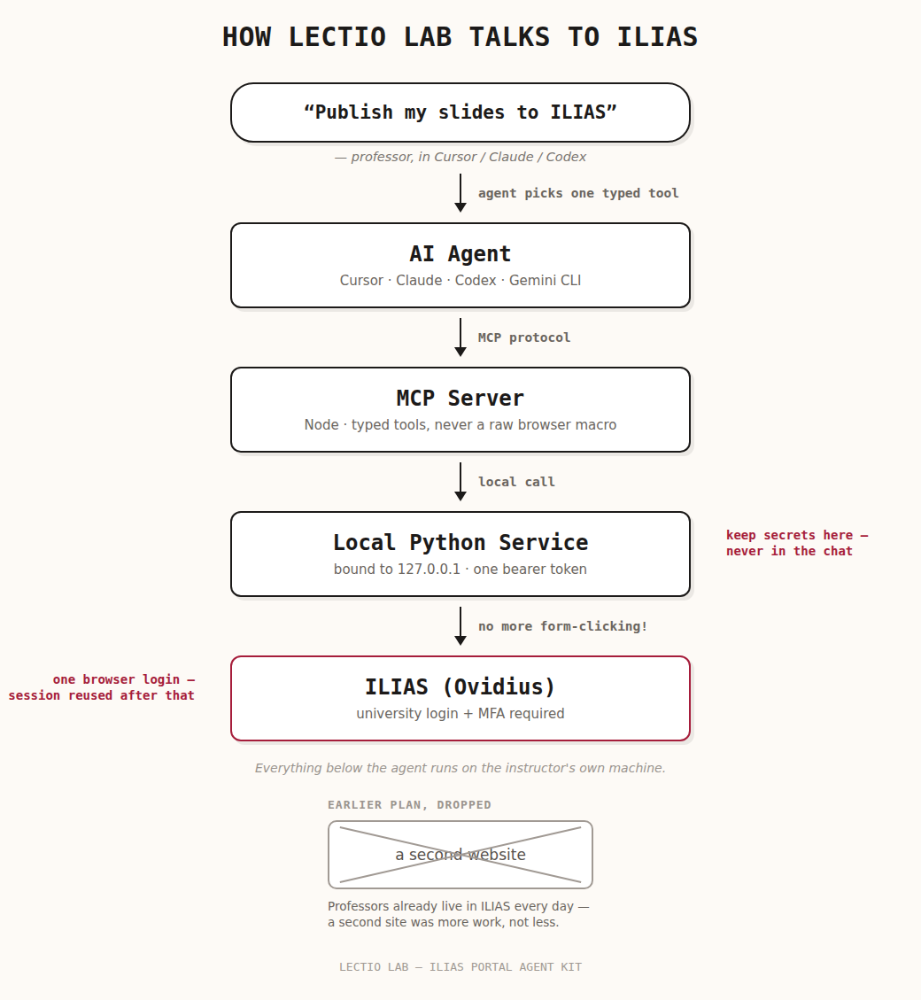
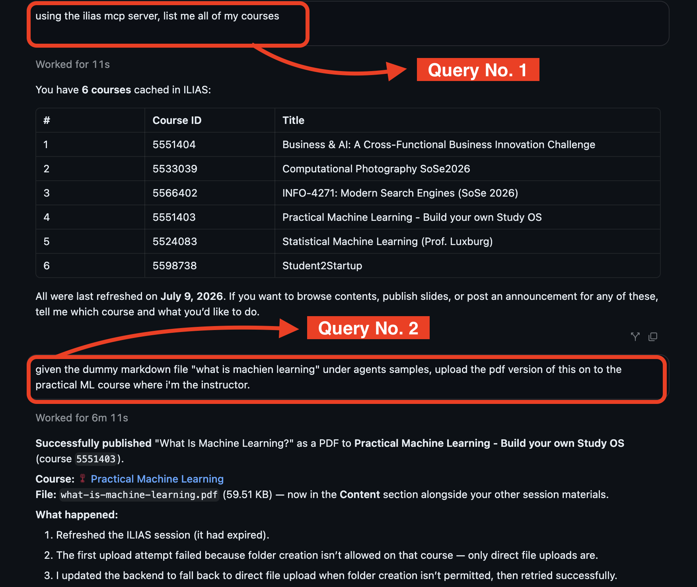

> **Project:** [[projects/lectio-lab|Lectio Lab]], built with Kourosh Sharifi ·
> [Source code](https://github.com/Lectio-Lab/ilias_portal) ·
> [Website](https://lectio-lab.github.io/website.github.io/)

In July 2026 I made the first commit of the ILIAS Portal: a clean Django backend
and an Angular frontend, about 20,000 lines. The idea was a web app where
professors at the University of Tübingen could prepare course material and push it
to ILIAS, the university's learning platform.

Two months later, the main thing that shipped was a commit that changed 72 files,
deleted about 5,400 lines and added about 1,500. This post explains why that was
the right call and what replaced the app.

## The feedback that killed the portal

We showed the portal to instructors. Their answer was short: _we already live inside
ILIAS every day. A second website is more work, not less._

That is hard to hear after building auth, accounts, a frontend and a backend. But
they were right. A portal only adds value if people choose to open it. Professors
were already opening something else every day: an AI agent such as ChatGPT, Claude
or Cursor. So the useful product was not another destination. It was a way for the
tool they already used to act on ILIAS for them.

## The shape of the replacement

The release has three parts:

1. **A TypeScript MCP server** with a fixed set of typed tools:
   `ilias_list_courses`, `ilias_publish_slides`, `ilias_edit_exercise`,
   `ilias_post_grade`, and others.
2. **A local Python service** listening only on `127.0.0.1`. It accepts a bearer
   token generated per installation and is the only component that talks to ILIAS.
3. **Agent skills** that teach the agent the workflows: finding the latest course
   content, finding teaching material, producing lecture content.

What we removed matters as much: no Django, no PostgreSQL, no Docker, no portal
accounts, no public web server. The professor installs a ZIP, logs in once through
the university's real login with MFA, and keeps talking to their agent.

## Typed tools instead of browser macros

The obvious shortcut would be a browser automation agent that clicks around ILIAS.
We avoided it on purpose. A generic browser agent guesses. It might click the wrong
course, overwrite the wrong exercise or submit half a form.

With typed tools, the agent has to pick one named operation with explicit
arguments, and all the ILIAS-specific logic is ordinary, tested Python. The model
only decides _which_ operation to run and _with what values_. That is a much
smaller and more reviewable space of mistakes.

## Every write is verified

The rule I care most about in the backend is that **a write is not done until we
have read it back**.

- `ilias_edit_exercise` edits one exact exercise, re-fetches it, and checks every
  requested field.
- `ilias_post_grade` is stricter, because grades matter most. The agent first calls
  `ilias_find_grade_target`, which returns the current exercise title, assignment
  title, status, mark and comment for one participant. When it then posts, it has to
  send those _expected current values_ back. If any of them changed in the meantime,
  the backend refuses with a message saying which fields went stale and asking for a
  new lookup. It also checks that the form action is an HTTPS URL on the ILIAS host
  before submitting, posts once, and re-reads the result.

This is the same discipline as optimistic concurrency control in a database, applied
to a web application we do not own.

## Things the agent is never allowed to do

Some rules are product decisions, not technical ones:

- **The agent never calculates, recommends, infers or chooses a grade.** It can only
  post a value the instructor gave it.
- **University passwords are never stored.** They are typed only into the visible
  login window. We keep only session cookies, written atomically to files with
  `0600` permissions in a `0700` directory.
- **The download proxy accepts only HTTPS URLs on the ILIAS host** with ILIAS asset
  paths, so the local service cannot be used to reach arbitrary or private-network
  addresses.

## What I took away

- **Talk to users before polishing.** We got to the right design by showing
  something real early and accepting a blunt answer.
- **Deleting code is a feature.** The final kit is smaller, easier to install and
  easier to audit than the portal it replaced. The build script even enforces a
  15 MiB size limit on the release ZIP.
- **Give agents narrow tools.** Typed operations with validation, guards and
  read-back checks make an AI integration safe enough for real coursework and grades.

---

[[projects/lectio-lab|Project overview →]] · [[blog/index|All articles →]]
