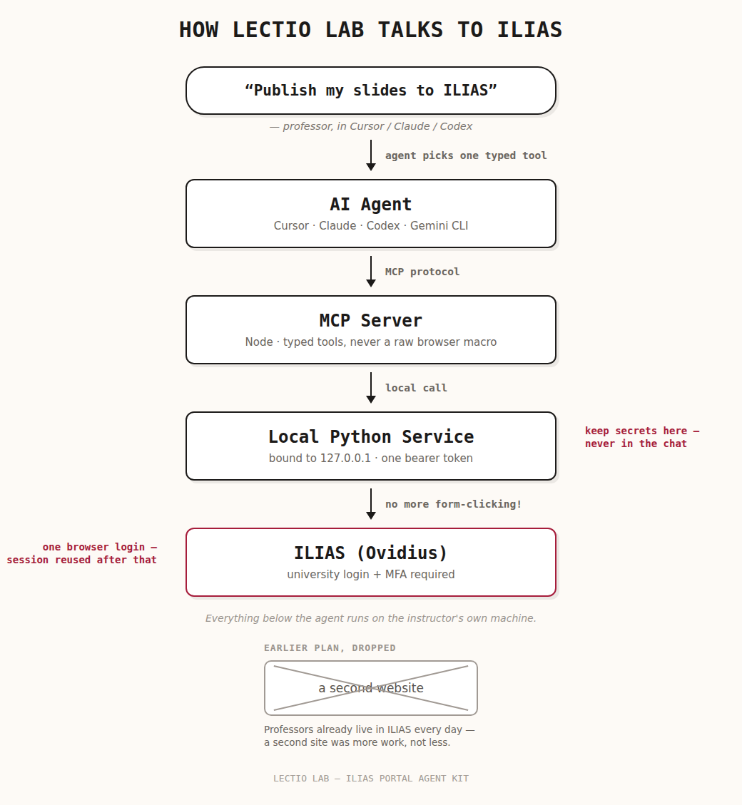
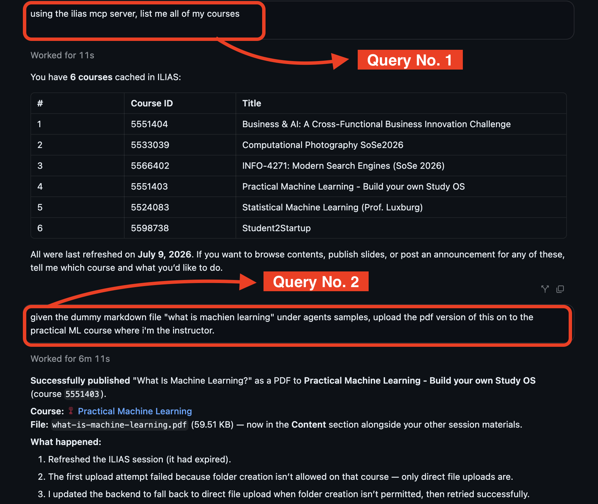

## Lectio Lab

**Open-Source Team Project · Lectio Lab · Jul 2026 – Sep 2026**

**Built with [Kourosh Sharifi](https://github.com/KouroshKSH)**

Lectio Lab lets professors and instructors at the University of Tübingen work with the
university's ILIAS learning platform by describing what they want to their AI agent
("publish these slides to week 5", "post this mark for this student") instead of
clicking through ILIAS's web forms.

### How it works

The agent never drives a browser. It calls one of a small set of exact, typed
[MCP](https://modelcontextprotocol.io/) tools. A TypeScript MCP server forwards each
call to a small Python service that listens only on `127.0.0.1`, and that service is the only
component that talks to ILIAS. It holds the ILIAS session cookies and a bearer token
generated per installation. The instructor logs in once in a visible browser
window, including the university's MFA, and the session is reused after that.

The MCP tool surface covers the instructor's daily work:

| Area       | Tools                                                                                                                |
| :--------- | :------------------------------------------------------------------------------------------------------------------- |
| Session    | `ilias_check_setup`                                                                                                  |
| Courses    | `ilias_list_courses`, `ilias_refresh_courses`, `ilias_get_course_contents`, `ilias_find_course_items`                |
| Publishing | `ilias_publish_assignment`, `ilias_publish_slides`, `ilias_publish_markdown_as_slides`, `ilias_publish_announcement` |
| Editing    | `ilias_edit_exercise`                                                                                                |
| Grading    | `ilias_find_grade_target`, `ilias_post_grade`                                                                        |
| Files      | `ilias_download_file`                                                                                                |

### What I built

- **The first version:** a Django backend and an Angular frontend, which together
  made a separate portal where professors would prepare course material.
- **The pivot to MCP:** when we showed the portal to instructors, they told us
  plainly that they already spend their day inside ILIAS and a second website meant
  more work for them, not less. I refactored the professor kit into a lean local MCP
  service. That one change deleted about 5,400 lines and dropped Django, PostgreSQL,
  Docker and portal accounts from the release path.
- **Verified writes:** exercise edits and grade posts re-fetch the page from ILIAS
  after writing and check every requested field. A grade post also checks the
  values the agent saw when it located the target: if anything changed in between,
  it refuses to write and asks the agent to look the target up again.
- **Authentication:** I changed the kit to require an interactive MFA login. Together
  with Kourosh's change so that university passwords are never stored, the service
  keeps only session cookies, in files with `0600` permissions.
- **Agent skills:** I wrote skills for resolving the latest course content, finding
  teaching material, and producing lecture content (Hero Content Maker), plus a
  practical RAG teaching module.

A hard rule runs through the whole design: **the agent never calculates, recommends,
or chooses a student's grade.** It can only post a grade that the instructor gives it.

### Explore

- **[[blog/lectio-lab-ilias-mcp|Read the engineering write-up →]]**
- **[Source code →](https://github.com/Lectio-Lab/ilias_portal)**
- **[Project website →](https://lectio-lab.github.io/website.github.io/)**

### Stack and topics

`Python` · `TypeScript` · `Model Context Protocol` · `Node.js` · `Playwright` ·
`Django & Angular (v1)` · `Session Security` · `Agent Tooling` · `ILIAS`
